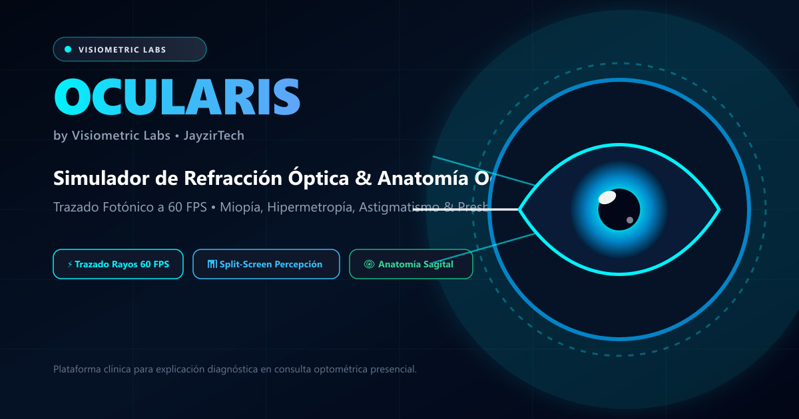

# 👁️ Ocularis — Simulador Interactivo de Refracción y Física Óptica
> **by Visiometric Labs • JayzirTech**  
> *Plataforma Pedagógica y de Consulta Optométrica Presencial*

🌐 **[English](./README.md)** • **[Español]**

[](https://visiometric-labs.github.io/refraction-simulator/)
[](https://www.docker.com/)
[]()
[-F7DF1E?logo=javascript&logoColor=black)](https://developer.mozilla.org/es/docs/Web/JavaScript)
[](https://vitejs.dev/)
[](https://github.com/visiometric-labs)



---

## 🌐 Demo Pública en Vivo
Accede al simulador interactivo de refracción desplegado en producción:  
👉 **[https://visiometric-labs.github.io/refraction-simulator/](https://visiometric-labs.github.io/refraction-simulator/)**

---

## 📌 ¿Qué es Ocularis?
Un simulador visual interactivo diseñado para la consulta optométrica presencial. Permite a los profesionales de la salud visual demostrar con claridad matemática y pedagógica a los pacientes cómo las anomalías refractivas (**miopía**, **hipermetropía**, **astigmatismo** y **presbicia**) alteran el punto de enfoque sobre la retina, y cómo las lentes oftálmicas (divergentes, convergentes, tóricas y progresivas) restauran la nitidez foveal.

---

## 🌟 Características Principales

1. **Simulador de Percepción con Comparador Split-Screen:**
   - Comparador interactivo Antes / Después con divisor deslizable en tiempo real.
   - Demostración de visión del paciente vs. corrección con optotipo Snellen retroiluminado y luces nocturnas con efecto Bokeh realista y sombras de astigmatismo.

2. **Trazado de Rayos Fotónicos a 60 FPS:**
   - Convergencia precisa de rayos de luz atravesando córnea, cámara anterior, cristalino y vítreo hasta la retina/fóvea.
   - Simulación física de focos pre-retinianos, post-retinianos e Intervalo de Sturm.

3. **Lentes Correctoras Dinámicas:**
   - **Lentes Divergentes (—):** Geometría cóncava para corrección de miopía.
   - **Lentes Convergentes (+):** Geometría convexa para hipermetropía.
   - **Lentes Cilíndricas / Tóricas:** Perfil meridional asimétrico para astigmatismo.
   - **Lentes Progresivas:** Canal de adición variable para presbicia.

4. **Flujo Pedagógico Guiado en 11 Etapas:**
   - Recorrido completo desde la anatomía sagital hasta la síntesis clínica.

5. **Modo Kiosco con Auto-Reset (10 Minutos):**
   - Regreso automático a la pantalla de bienvenida si no hay actividad en 10 minutos (configurable con `?timeout=ms`).

6. **Optimización para Tablets y Computadores Clínicos (≥768px):**
   - Puerta de acceso para móviles (*Mobile Gate*).
   - Botón de ocultar/restaurar cuadro clínico en iPad para máxima visibilidad ocular.
   - Pantalla completa nativa por API.

---

## 🛠️ Tecnologías Empleadas

| Componente | Tecnología | Detalle |
|---|---|---|
| **Bundler / Dev Server** | Vite 6 | Recarga HMR instantánea y compilación optimizada |
| **Lógica / Core** | Vanilla JavaScript (ES Modules) | 60 FPS garantizados sin sobrecarga de frameworks |
| **Motor de Renderizado** | HTML5 Canvas 2D | Trazado de rayos, biofotónica y partículas |
| **Estilos** | CSS Vanilla Modular | Arquitectura limpia: `theme`, `layout`, `components`, `landing` |
| **Servidor Producción** | Nginx Alpine | Imagen Docker de ~25 MB con gzip y caché inmutable |
| **Contenedores** | Docker & Docker Compose | Despliegue reproducible en 1 comando |

---

## 🚀 Puesta en Marcha

### Con Node.js
```bash
npm install
npm run dev
# Acceder en: http://localhost:5173/
```

### Con Docker
```bash
docker compose up -d --build
# Acceder en: http://localhost:8080/
```

---

## 📄 Licencia

Software propietario. Todos los derechos reservados © JayzirTech • Ocularis by Visiometric Labs.
