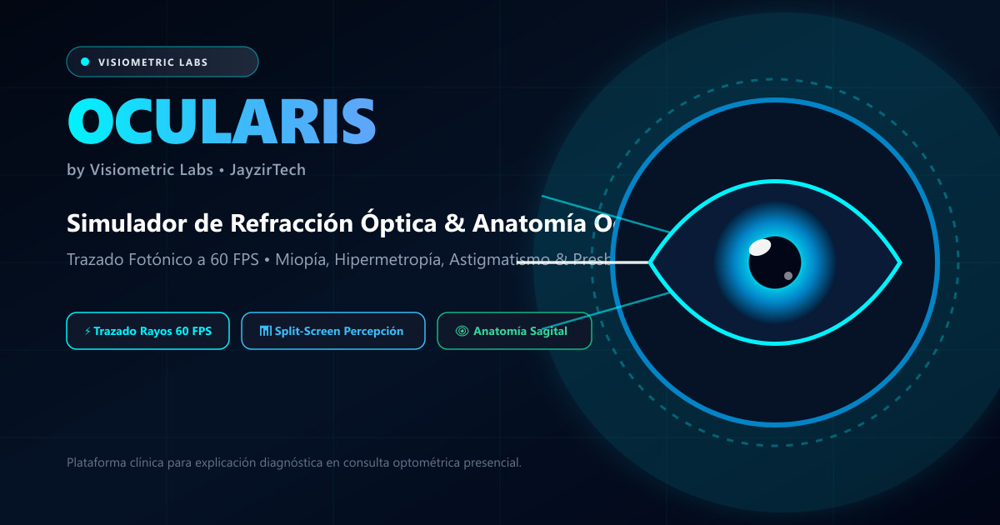

# 👁️ Ocularis — Interactive Refraction & Optical Physics Simulator
> **by Visiometric Labs • JayzirTech**  
> *In-Person Clinical Optometric Consultation & Refractive Visual Education Tool*

[](https://visiometric-labs.github.io/refraction-simulator/)
[](https://www.docker.com/)
[]()
[-F7DF1E?logo=javascript&logoColor=black)](https://developer.mozilla.org/en-US/docs/Web/JavaScript)
[](https://vitejs.dev/)
[](https://github.com/visiometric-labs)



[**English**](#-english-version) | [**Español**](#-versión-en-español)

---

## 🌐 Live Public Demo
Access the interactive refraction simulator deployed live:  
👉 **[https://visiometric-labs.github.io/refraction-simulator/](https://visiometric-labs.github.io/refraction-simulator/)**

---

## 🌐 English Version

Interactive visual simulator designed for in-person optometric consultations. It enables eye care professionals to clearly demonstrate to patients how refractive anomalies (**myopia**, **hyperopia**, **astigmatism**, and **presbyopia**) affect visual focus, and how ophthalmic lenses (divergent, convergent, toric, and progressive) restore sharp retinal convergence.

> **Disclaimer:** This software is an educational visualization and communication tool for clinical consultations. It is not intended for diagnostic purposes.

### 🌟 Key Features

1. **Dual Split-Screen Perception Simulator:**
   - Interactive Before/After split comparator with draggable dividing bar.
   - Real-time simulation of patient visual perception vs. optical correction using a clinical Snellen optotype chart and high-contrast night street lights (bokeh circles and astigmatic ghosting).

2. **Accurate 2D Photonic Ray Tracing (60 FPS):**
   - High-fidelity light ray convergence across the cornea, anterior chamber, crystalline lens, and vitreous humor onto the fovea.
   - Dynamic simulation of focal planes: pre-retinal focus (myopia), virtual post-retinal focus (hyperopia and presbyopia), and interval of Sturm / multiple focal planes (astigmatism).

3. **Dynamic Corrective Lenses:**
   - **Divergent Lenses (—):** Concave geometry with thick edges and thin optical center for myopia correction.
   - **Convergent Lenses (+):** Convex geometry with central bulge for hyperopia correction.
   - **Cylindrical / Toric Lenses:** Asymmetric meridian profile to correct corneal astigmatism.
   - **Progressive Lenses (Multifocal):** Variable addition channel for presbyopia, restoring reading acuity while preserving distance vision.

4. **11-Stage Guided Pedagogical Workflow:**
   1. *Macro-Eye Hero:* Photorealistic stylized eye with reactive pupil and biometric iris.
   2. *Sagittal Anatomy Explorer:* Interactive exploration of cornea, anterior chamber, crystalline lens, vitreous humor, and retina.
   3. *Myopia Physics:* Axial elongation and divergent lens correction.
   4. *Myopia Perception Simulation:* Split-screen distant blur demo.
   5. *Hyperopia Physics:* Axial shortening and convergent lens correction.
   6. *Hyperopia Perception Simulation:* Split-screen near-vision blur demo.
   7. *Astigmatism Physics:* Corneal asymmetry and cylindrical lens correction.
   8. *Astigmatism Perception Simulation:* Split-screen directional ghosting demo.
   9. *Presbyopia Physics:* Lens rigidity, distance/near focus, and progressive addition.
   10. *Presbyopia Perception Simulation:* Split-screen reading blur demo.
   11. *Clinical Synthesis:* Summary and consultation wrap-up.

5. **Tablet & Clinical Desktop Optimization (≥768px):**
   - **Mobile Gate:** Informs smartphone users to open the app on an iPad, tablet, or desktop.
   - **Tablet Mode (768px - 1024px):** Scaled typography and a dedicated button to **hide/restore** the explanatory card for unobstructed view of the eyeball.
   - **Native Fullscreen:** Triggered via user gesture for clinical immersion.

---

### 🛠️ Technical Stack

| Layer | Technology | Details |
|---|---|---|
| **Bundler / Dev Server** | Vite 6 | Instant HMR, zero-config production bundle |
| **Logic / Core** | Vanilla JavaScript (ES Modules) | High-performance 60 FPS loop without heavy framework overhead |
| **Optics Rendering Engine** | HTML5 Canvas 2D | Ray tracing, bioluminescent glow, laser sweeps, and particles |
| **Anatomy Layer** | Synchronized HTML5 / SVG Pins | High-DPI Retina/4K responsive coordinates |
| **Styling** | Modular Vanilla CSS | Dark medical design system with glassmorphism |
| **Production Server** | Nginx Alpine | Multi-stage image (~25 MB), gzip compression, immutable cache |
| **Containerization** | Docker & Docker Compose | 1-command reproducible deployment |

---

### 🚀 Getting Started

#### Option 1: Docker (Recommended)

**Prerequisites:** Docker and Docker Compose installed.

```bash
# Build and run container in background
docker compose up -d --build

# Open in browser:
http://localhost:8080/

# View logs:
docker compose logs -f

# Stop container:
docker compose down
```

#### Option 2: Local Development (Node.js)

**Prerequisites:** Node.js 18+ and npm.

```bash
# Install dependencies
npm install

# Start Vite dev server
npm run dev

# Open in browser:
http://localhost:5173/
```

---

### 📁 Project Structure

```
├── Dockerfile                      # Multi-stage production build (Node + Nginx)
├── docker-compose.yml              # Single-command container orchestration
├── nginx.conf                      # Production HTTP server config (gzip, security headers)
├── index.html                      # Main HTML structure & HUD overlays
├── package.json                    # Project metadata & scripts
├── vite.config.js                  # Vite configuration
│
└── src/
    ├── main.js                     # Application orchestrator & scene switcher
    ├── core/
    │   ├── device-guard.js         # Mobile gate detection & Fullscreen API
    │   ├── events.js               # Pub/sub event bus
    │   └── state-machine.js        # 11-stage finite state machine
    ├── engine/
    │   └── optical-engine.js       # 60 FPS Canvas engine, transitions & particles
    ├── simulation/
    │   ├── eye-model.js            # Anatomical & geometric eye coordinates
    │   └── lenses.js               # Mathematical lens curvature & deflection
    ├── components/
    │   ├── macro-eye.js            # Stage 1: Frontal hero eye
    │   ├── anatomy-explorer.js     # Stage 2: Sagittal cross-section explorer
    │   ├── refraction-scene.js     # Stages 3, 5, 7, 9: Ray tracing & controls
    │   ├── perception-simulator.js # Stages 4, 6, 8, 10: Split-screen comparator
    │   ├── synthesis-scene.js      # Stage 11: Clinical wrap-up
    │   └── hud.js                  # Fixed timeline & navigation HUD
    └── styles/
        └── index.css               # Medical dark design system & responsive rules
```

---

## 🇪🇸 Versión en Español

Simulador óptico interactivo diseñado para la consulta optométrica presencial. Permite al profesional de la salud visual explicar al paciente, de forma clara y cinematográfica, cómo funcionan afecciones como la **miopía**, la **hipermetropía**, el **astigmatismo** y la **presbicia (vista cansada)**, y cómo actúan las lentes correctoras (divergentes, convergentes, tóricas y progresivas).

> **Aviso:** Esta aplicación es una herramienta pedagógica de comunicación clínica. No está destinada al diagnóstico médico.

### 🌟 Características Principales

1. **Simulador de Percepción con Comparador Split-Screen:**
   - Comparador Antes / Después con divisor deslizable interactivo.
   - Simulación en tiempo real de la visión del paciente frente a la visión corregida mediante un optotipo Snellen retroiluminado y farolas nocturnas de alto contraste (bokeh y aberración astigmática).

2. **Trazado de Rayos Fotónicos a 60 FPS:**
   - Convergencia precisa de rayos de luz atravesando córnea, cámara anterior, cristalino y vítreo hasta la fóvea.
   - Simulación de focos pre-retinianos (miopía), focos virtuales post-retinianos (hipermetropía y presbicia) y meridianos perpendiculares con dos focos (astigmatismo).

3. **Lentes Correctoras Dinámicas:**
   - **Lente Divergente (—):** Geometría cóncava con bordes gruesos y centro delgado para miopía.
   - **Lente Convergente (+):** Geometría convexa con abombamiento central para hipermetropía.
   - **Lente Cilíndrica / Tórica:** Perfil meridional asimétrico para compensar el astigmatismo corneal.
   - **Lente Progresiva (Multifocal):** Pasillo de adición variable para presbicia que devuelve nitidez en lectura cercana preservando la visión de lejos.

4. **Recorrido Clínico de 11 Etapas:**
   1. *Macro-Ojo General:* Vista frontal con pupila reactiva e iris biofotónico.
   2. *Explorador Anatómico:* Píldoras interactivas sobre córnea, cristalino, vítreo y retina.
   3. *Física de la Miopía:* Elongación axial y lente divergente.
   4. *Simulación de Visión Miópica:* Split-screen interactivo con desenfoque lejano.
   5. *Física de la Hipermetropía:* Acortamiento axial y lente convergente.
   6. *Simulación de Visión Hipermétrope:* Split-screen con desenfoque de cerca y fatiga.
   7. *Física del Astigmatismo:* Asimetría corneal y lente cilíndrica.
   8. *Simulación de Visión Astigmática:* Split-screen con sombras dobles direccionales.
   9. *Física de la Presbicia:* Cristalino rígido, distancia de lectura y adición progresiva.
   10. *Simulación de Visión con Presbicia:* Split-screen con lectura borrosa.
   11. *Síntesis y Conclusión:* Repaso pedagógico y plan correctivo.

5. **Optimización para Tablets y Computadores (≥768px):**
   - **Mobile Gate:** Notificación para smartphones indicando que se requiere tablet o computador.
   - **Modo Tableta (768px - 1024px):** Tipografías proporcionales y botón para **ocultar / mostrar** el cuadro de conceptos, dejando el globo ocular 100% visible.
   - **Pantalla Completa Nativa:** Activación fluida mediante gesto de inicio.

---

### 🛠️ Tecnologías Empleadas

| Componente | Tecnología | Justificación |
|---|---|---|
| **Bundler / Servidor Dev** | Vite 6 | Recarga HMR instantánea y compilación optimizada |
| **Lógica** | Vanilla JavaScript (ES Modules) | 60 FPS garantizados sin dependencias de frameworks |
| **Motor de Renderizado** | HTML5 Canvas 2D | Trazado de rayos, partículas en suspensión y efectos bioluminiscentes |
| **Pines Anatómicos** | HTML5 / SVG reactivo | Coordinación de coordenadas en pantallas Retina/4K |
| **Estilos** | CSS Vanilla Modular | Design system médico oscuro con glassmorphism |
| **Servidor de Producción** | Nginx Alpine | Imagen ligera de ~25 MB con gzip y caché inmutable |
| **Contenedor** | Docker & Docker Compose | Despliegue idéntico en cualquier entorno |

---

### 🚀 Instrucciones de Ejecución

#### Opción 1: Docker (Recomendada)

**Requisitos:** Docker y Docker Compose instalados.

```bash
# Construir imagen y levantar contenedor en segundo plano:
docker compose up -d --build

# Acceder en el navegador:
http://localhost:8080/

# Ver registros de actividad:
docker compose logs -f

# Detener el contenedor:
docker compose down
```

#### Opción 2: Desarrollo Local (Node.js)

**Requisitos:** Node.js 18+ y npm.

```bash
# Instalar dependencias
npm install

# Iniciar servidor Vite
npm run dev

# Acceder en el navegador:
http://localhost:5173/
```

---

### 🌐 Ecosistema Visiometric Labs

Este simulador forma parte de la suite modular de simulación óptica de **Visiometric Labs**:
- **`refraction-simulator`**: Anomalías refractivas y corrección con lentes (Miopía, Hipermetropía, Astigmatismo, Presbicia).
- **`optical-filters-simulator`**: Filtros y tratamientos de luz (Antirreflejante, Filtro Azul, Fotocromático, Polarizado).
- **`eye-pathologies-simulator`**: Patologías oculares (Cataratas, Glaucoma, Degeneración Macular).
- **`lens-types-simulator`**: Tipos y geometrías de lentes oftálmicas.
- **`smart-optical-platform`**: Plataforma unificada de configuración visual en diferentes entornos.

---

## 📄 License

Proprietary software. All rights reserved © Visiometric Labs.
